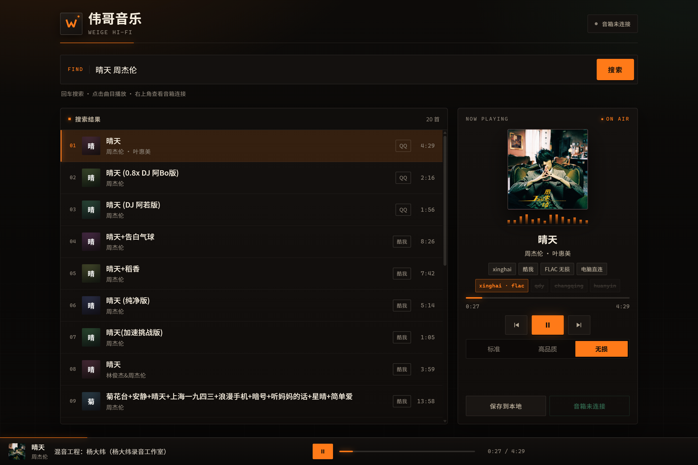
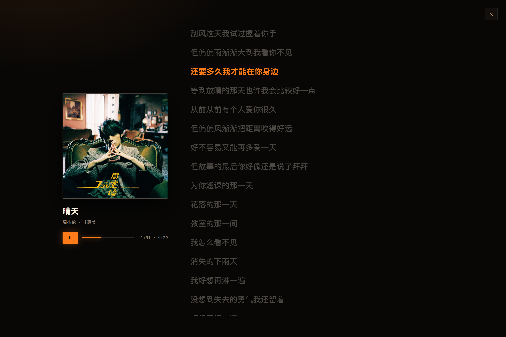
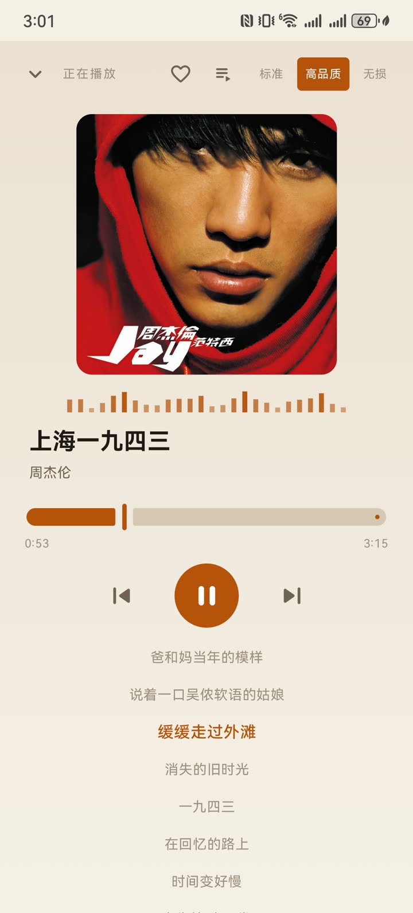
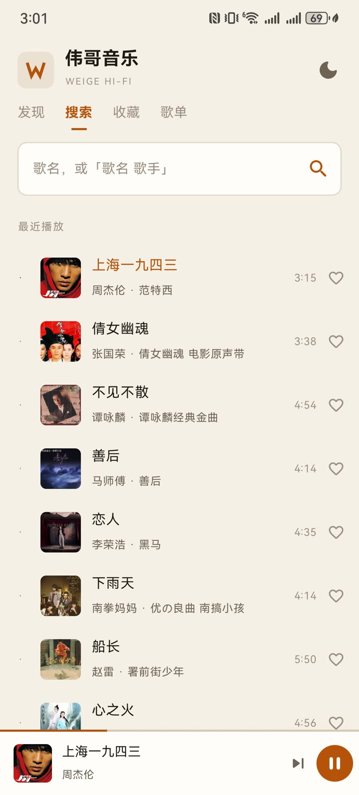

<div align="center">

# 伟哥音乐 · Weige Hi-Fi

**一个能搜歌、能放歌、还能指挥 ESP32 小智音箱的本地音乐播放器**

[](../../releases/latest)
[](#安装与启动)
[](LICENSE)

</div>

---

## 界面

**桌面端（Web）**

<table>
<tr>
<td width="50%"></td>
<td width="50%"></td>
</tr>
<tr>
<td align="center"><sub>搜索、试听、切换音源与音质</sub></td>
<td align="center"><sub>全屏歌词，跟随播放逐行高亮</sub></td>
</tr>
</table>

**Android**

<p align="center">
  
  
  
</p>

<p align="center"><sub>发现歌单 · 播放与歌词 · 搜索与最近播放</sub></p>

---

## 这是什么

一个跑在自己电脑上的音乐播放器。搜歌、播放、歌词、存到本地，都在浏览器里完成。

它还有后半段能力：把正在听的歌**推给客厅那台 ESP32 小智音箱**。配好之后，对着音箱说一句「播放晴天」，它就会去你的库里找歌放——曲库和音源都在你自己手上。

本篇先讲 Web 端怎么用，再讲音箱联动怎么配。

## Web 端

### 安装与启动

**方式一：下载可执行文件（推荐）**

到 [Releases](../../releases/latest) 下载 `WeigeMusic.exe`，双击即用。

单文件打包，内含 Node 运行时、前端页面、音源脚本和 ffmpeg，目标机器**不需要装任何东西**。首次运行会在同级目录解压 ffmpeg，之后启动很快。

**方式二：从源码运行**

```bash
cd server
npm install
node server.js
```

打开 `http://127.0.0.1:8090`。需要 Node.js ≥ 20（用到内置 `fetch` 与 `WebSocket`）。

打包成单文件：

```bash
npm run build      # 输出 dist/WeigeMusic.exe
```

### 怎么用

**搜歌**

在顶部输入框里打「歌名」或「歌名 歌手」，回车即可。右边橙色的 **搜索** 按钮效果一样。

结果列表每行显示：序号、歌名、歌手 · 专辑、来源平台（QQ / 酷我）、时长。**点任意一行就开始播**。

列表里可能出现同一首歌的多个版本（DJ 版、加速版、串烧合集）。选哪个都行，点下去就换。

**播放**

点歌后右侧面板会依次出现：封面 → 实时电平 → 曲名 → 歌手 → 音源标签 → 音质档位 → 进度条 → 控制键。底栏同时出现一条迷你播放条，左边是当前曲目，中间是滚动歌词，右边是进度。

几个常用操作：

| 想做什么 | 怎么做 |
|---|---|
| 换一个音源 | 点面板里那排音源标签（xinghai / 酷我 / 电脑直连…） |
| 换音质 | 点「标准 / 高品质 / 无损」，拿不到会自动降级 |
| 看完整歌词 | 点底栏中间那片歌词区域，进入全屏歌词 |
| 存到本地 | 点「保存到本地」，文件落在程序目录的 `saved/` |
| 换歌 | 上一首 / 下一首，或直接点列表里的另一行 |

**全屏歌词**

点底栏歌词区打开。当前行用琥珀色高亮，整页随之滚动。点右上角 ✕ 或按 `Esc` 退出。

歌词和翻译来自音源平台，歌本身没有收录时这里会显示提示，不影响播放。

**音质与音源**

- 三档：**无损 / 高品质 / 标准**。选无损但源没有 FLAC 时，会自动退到 320k 再到 128k
- 多个音源会依次尝试，前面几个失败也能出歌，失败原因打在日志里
- 有一道**时长对账**：搜索结果说 4:29，实际拿到的只有 1:30，会判定为试听片段并换源。反向也拦——4:29 的歌拿到 13:58 的串烧合集同样不要

### 接口速查

想自己接一层的话，常用的几个：

| 路径 | 说明 |
|---|---|
| `GET /api/search?kw=` | 搜索 |
| `GET /api/play?kw=&target=pc\|device` | 解析并准备播放 |
| `GET /orig/<token>` | 原音质直通，支持 Range（浏览器用） |
| `GET /api/save?kw=` | 保存到本地 `saved/` |

---

## 和 ESP32 小智联动

### 为什么需要这一层

小智音箱（ESP32-S3）的解码器只有 **Opus**，固件固定单声道。所以不管源是 mp3、flac 还是 m4a，都得先转成 `OGG / Opus / 单声道 / 48 kHz` 才能播。

云端那套音乐服务曲库有限、链接也常失效。这里改成：**歌由你的电脑找，转码由你的电脑做，音箱只负责拉流播放。**

### 连接音箱

前提：音箱已刷入[下面的固件补丁](#固件补丁)，并且和电脑在同一个局域网。

1. 点页面右上角的状态胶囊（正常显示「音箱未连接」）
2. 输入设备地址，如 `192.168.1.50:8080`；不知道地址就点 **自动查找**
3. 保存后会记住，下次启动直接可用

「自动查找」会先把路由器 ARP 缓存里最近通信过的主机探一遍，找不到再补扫整个网段，通常几秒内出结果。判定依据不是「端口通不通」，而是设备 `/status` 返回的结构，避免认错同网段里别的服务。

地址优先级：`--device` 参数 > `DEVICE_IP` 环境变量 > `device.json` > 默认值。

连上之后，面板底部的「在音箱上播放」会亮起。点它，当前这首就会推到音箱。

### 语音点歌

配好 MCP 接入点之后，不用碰键盘：

> 「播放晴天」　「换一首周杰伦的」　「停一下」

**配置**

1. 在 [xiaozhi.me](https://xiaozhi.me) 的智能体设置里找到 **MCP 接入点**，复制 `wss://api.xiaozhi.me/mcp/?token=...`
2. 启动时传入，之后会自动记住：

```bash
WeigeMusic.exe --mcp-token "eyJhbGciOi..."
```

看到下面几行说明接通了：

```
云端 MCP   已启用（音箱可说「播放xx」直接点歌）
[MCP] 已连上，等待云端初始化
[MCP] 初始化握手完成（协议 2024-11-05）
[MCP] 云端拉取工具列表（3 个）
```

**它是怎么工作的**

本机**主动往外连**云端接入点，所以不需要公网 IP、不需要内网穿透。连上后向大模型暴露三个工具：

| 工具 | 作用 |
|---|---|
| `music_search` | 搜歌，返回「序号. 歌手 - 歌名（时长，平台）」 |
| `music_play` | 播歌，内部完成搜索 → 转码 → 推到音箱 |
| `music_stop` | 停止播放 |

关键点：**大模型只给歌名，不碰 URL**。转码和寻址全在本地完成，模型不需要知道你的内网地址。

**首播会等一会儿**

说「播放晴天」到真正出声，中间有一段等待：

- 之前播过的歌，几秒内就响
- 新歌通常 10–30 秒，瓶颈在**音源解析**（多个源依次尝试、各自等超时），不是转码
- 转码本身很快：一首 4 分钟的歌只需 5–8 秒 CPU，而且边转边发，不用等整首转完

### 固件补丁

补丁基于 [xiaozhi-esp32](https://github.com/78/xiaozhi-esp32) **v2.5.1**（MIT）。本仓库不整份拷贝上游代码，只提供改动：

```
firmware/patches/0001-add-music-http-and-remote-play.patch
```

包含四个部分：

| 文件 | 改动 |
|---|---|
| `main/music_http_server.{cc,h}` | **新增**。设备侧 HTTP 服务（默认 `:8080`）：`/play?url=`、`/stop`、`/status` |
| `main/mcp_server.cc` | **新增** `self.music.play(url, title)` 与 `self.music.stop` 两个 MCP 工具 |
| `main/application.{cc,h}` | `PlayMusic` 允许从 `listening` / `speaking` 直接插播；新增 `music_playing_` 标志，避免关闭音频通道时状态被误改回 idle |
| `main/CMakeLists.txt` | 注册新增的源文件 |

**应用与编译**

```bash
git clone https://github.com/78/xiaozhi-esp32.git
cd xiaozhi-esp32
git checkout v2.5.1
git am /path/to/0001-add-music-http-and-remote-play.patch

idf.py set-target esp32s3
idf.py build
idf.py -p COM5 flash
```

需要 ESP-IDF ≥ 6.0（本项目用 6.1 验证）。不擦 NVS 的话，WiFi 配网和激活状态都会保留。

**改固件时踩过的坑**

记在这里，省得别人重踩：

- 语音点歌时设备必然处于 `listening` 或 `speaking`（正在播 TTS 回复），**不会**是 `idle`。原固件的 `PlayMusic` 只接受 `idle`，所以用户永远点不响
- 状态机只允许 `listening/speaking → idle → notifying`，不能一步跳到 `notifying`
- 插播时要先 `CloseAudioChannel()` 结束当前对话，而这个回调原本会**无条件**把状态改回 `idle`，结果就是「音乐在响，但按停止没反应」

补丁的处理：放宽 `PlayMusic` 的状态限制，在主线程里先停旧歌、关通道、切 `idle`、等 150ms，再启动播放；同时用 `music_playing_` 挡住那个回调。

### 流式播放

音箱那条路不是「先转完再给链接」，而是边转边发：

```
ffmpeg -fflags nobuffer -probesize 65536 -analyzeduration 200000 \
       -i <远程直链> -c:a libopus -b:a 48k -f ogg pipe:1
                              │
                              ▼
                    直接写进 HTTP 响应
```

实测首字节 **0.1–0.5 秒**（整首转完再播要 10–40 秒）。副作用是内存从「整首进 buffer」降到几十 KB，也不再落盘。

代价：没有 `Content-Length`，所以这条流不支持拖动进度条。网页端走的是另一条支持 Range 的路径，不受影响。

---

## Android 版

手机端的独立播放器：不依赖电脑，也不含小智联动。界面见上方截图。

**发现** —— 推荐歌单加 7 类标签（专区 / 主题 / 心情 / 场景 / 年代 / 曲风流派 / 语言），
两列瀑布流、触底自动翻页；点进去整单入队，可以直接「播放全部」。

**播放** —— 800×800 高清封面、逐行歌词、VU 电平、上一首 / 下一首、后台播放与通知栏控制。
歌词优先取酷我（和音源同版本，时间轴最准），酷我缺词的歌自动走网易云兜底。

**搜索 / 收藏 / 自建歌单** —— 搜歌结果整列表入队；收藏与自建歌单都存在本地，重启不丢。

其他：

- 音源和 PC 端同源：内置 **QuickJS** 跑洛雪 JS 脚本，启动时按 24 小时周期自动更新
- 手机网络访问不到 GitHub 时，用 APK 里预置的脚本快照兜底，不会开不了张
- 深色 / 浅色两套主题，默认浅色

安装：从 [Releases](../../releases/latest) 下载 `WeigeMusic-x.y.z-release.apk`，需要 Android 8.0+。

> 正式包的签名和调试包不同。之前装过 `-debug` 版本的话，要先卸载才能装（收藏和歌单会丢）。

源码在 [`android/`](android/)，构建说明见 [android/README.md](android/README.md)。

## 目录结构

```
.
├── server/                  Web 服务（Node.js）
│   ├── server.js            HTTP 服务与接口
│   ├── lib/
│   │   ├── transcode.js     OGG/Opus 流式转码
│   │   ├── device.js        音箱地址管理与自动发现
│   │   ├── mcp.js           云端 MCP 桥
│   │   ├── search.js        双平台搜索
│   │   ├── resolve.js       音源解析与降级
│   │   └── ...
│   ├── sources/             音源脚本（洛雪格式）
│   ├── public/              前端页面（单文件）
│   └── build-exe.js         打包脚本
├── android/                 Android 客户端（Kotlin + Compose）
│   ├── app/src/main/java/com/weige/music/
│   │   ├── script/          QuickJS 引擎 + 音源脚本仓库
│   │   ├── play/            队列播放（ResolvingDataSource 按需解析）
│   │   └── ui/              Compose 界面
│   └── app/src/main/assets/sources/   内置音源脚本快照
├── firmware/patches/        ESP32 固件补丁
└── docs/screenshots/        README 用图
```

## 已知限制

- **音源是第三方的**，随时可能改接口或失效。失效时日志会打印每个源的具体错误
- **新歌首播偏慢（10–30 秒）**，瓶颈在音源解析的重试，不在转码
- **设备只支持 Opus**，无损/320k 的源最终都会转成 48 kbps 单声道。想要更高码率得改固件解码配置
- **MCP 语音点歌依赖接入点 token**，有效期约一年，过期重新复制
- 面板上的「电脑直连」是原音质直通，只给浏览器用，音箱拉不了（格式不对）
- **Android 歌词可能与版本对不上**：酷我缺词的歌走网易云兜底，按「歌名 + 歌手」匹配，
  Live 版和录音室版的时间轴不一致时会差一两秒
- **个别在线歌单服务端是空的**（专区里的「经典国语」这类），点开会自动换成同名的同类歌单，
  会弹提示说明

## 声明

- 本项目**仅供学习交流**，请支持正版音乐
- 音源脚本位于 `server/sources/`，来自洛雪音乐社区公开分享，版权归原作者（文件头保留了 `@author` 与 `@homepage`）
- `firmware/` 下的补丁基于 [xiaozhi-esp32](https://github.com/78/xiaozhi-esp32)（MIT），遵循其协议
- 名称与图形仅用于个人项目，与任何药品或商标无关

## License

[Apache-2.0](LICENSE)
