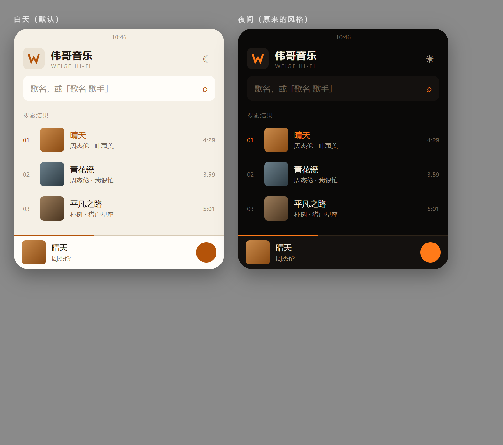

# 伟哥音乐 · Android

手机端独立播放器。搜歌、播放、歌词都在手机本地完成，**不需要电脑**，也不含小智音箱联动。

## 直接安装

```
WeigeMusic-1.0.0-debug.apk
```

传到手机点开安装（需允许"安装未知来源应用"）。

- 需要 Android 8.0（API 26）及以上
- 首次搜索会请求网络权限，Android 13+ 会询问通知权限（用于锁屏/通知栏控制）

## 主题

默认**白天模式**（米白纸感 + 深琥珀强调）。点右上角的 ☾ 切到**夜间模式**（暖黑 + 亮琥珀），
选择记在本地，下次启动还是上次那套。

<p></p>

> 白天模式的强调色压深了一档（`#B45309`）—— 直接用夜间的亮琥珀 `#FF7A18` 放在白底上会发飘，
> 歌名和小字都会糊。

## 从源码构建

需要 JDK 17 与 Android SDK（platform 35 + build-tools 34+）：

```bash
# 指向你的 SDK
echo "sdk.dir=D:\\android-sdk" > local.properties

./gradlew assembleDebug
# 产物：app/build/outputs/apk/debug/app-debug.apk
```

> 依赖仓库走的是阿里云镜像。Google Maven 在国内直连会超时，
> 配置在 `settings.gradle.kts`，换成官方源反而会更慢或失败。

## 音源

**音源不是写死的**，走的是洛雪音乐那套 JS 脚本，运行方式也和洛雪移动版一致：

- 内置 **QuickJS** 引擎 + 一份预加载脚本（`assets/script/user-api-preload.js`），
  把脚本需要的 `globalThis.lx`（`request` / `on` / `send` / `EVENT_NAMES` / `utils`）搭起来
- 脚本从 [pdone/lx-music-source](https://github.com/pdone/lx-music-source) 的清单拉取，
  经 `gh-proxy.org` 加速；解析出地址后原样缓存到 `filesDir/sources/`
- **启动时检查**：距上次更新超过 24 小时就自动刷新
- **失败时检查**：取流连续失败 3 次，立刻强制刷新一次清单
- 网络异常时不影响已有缓存，下次再试

取流顺序：

```
音源脚本（按 changqing → xinghai → qdy → huanyin 优先级，最多试 3 个）
      ↓ 全部失败
内置直链模板（haitangw）—— 只保证"还有一条路"，接口改版就会失效
```

搜索、歌词、封面不走脚本，直接调酷我的公开接口：

| 用途 | 接口 |
|---|---|
| 搜索 | `search.kuwo.cn/r.s`（客户端版参数，能拿到真原版） |
| 歌词 | `m.kuwo.cn/newh5/singles/songinfoandlrc?musicId=` |
| 封面 | `img4.kuwo.cn/star/albumcover/` |

注意歌词接口必须带完整桌面 UA，只写 `Mozilla/5.0` 会被判成非法客户端。

## 结构

```
app/src/main/java/com/weige/music/
├── MainActivity.kt         入口 + 通知权限 + 音源初始化
├── App.kt                  页面组装、迷你播放条
├── AppViewModel.kt         搜索 / 播放 / 歌词 / 收藏 / 歌单 / 发现
├── data/
│   ├── KuwoApi.kt          搜索、歌词（酷我优先 + 网易云兜底）、封面
│   └── PlaylistApi.kt      在线歌单：标签体系、列表分页、详情
├── model/
│   ├── Song.kt             歌曲与音质档位
│   ├── Playlist.kt         本地自建歌单
│   └── OnlinePlaylist.kt   在线歌单与标签
├── script/
│   ├── UserApiEngine.kt    QuickJS 引擎 + native 桥（request / utils / timeout）
│   ├── ScriptRepository.kt 脚本清单拉取、缓存、24h 更新
│   └── MusicSource.kt      取流入口：脚本优先，模板兜底，失败触发刷新
├── play/
│   ├── PlaybackService.kt  MediaSessionService（后台播放 + 通知栏）
│   ├── PlayerController.kt MediaController 封装，对外只暴露 StateFlow
│   └── SongRegistry.kt     songId → Song，供 ResolvingDataSource 反查
└── ui/                     Compose 界面（发现 / 搜索 / 播放 / 歌单详情 / 组件）
```

## 已知限制

- 搜索只接了酷我一个平台。脚本取流支持 5 个平台（kw/kg/tx/wy/mg），但搜索结果里只有酷我的曲目
- 无损档位依赖上游，拿不到时会静默回落到能拿到的最高档
- 少数音源脚本用到 AES/RSA 加密接口（`lx.utils.crypto`），这两个 native 函数目前是空实现，
  这类脚本会自己报错并被跳过，不影响其它脚本
- 音源脚本高度混淆，行为随上游变化，App 侧不做解析，只负责执行
